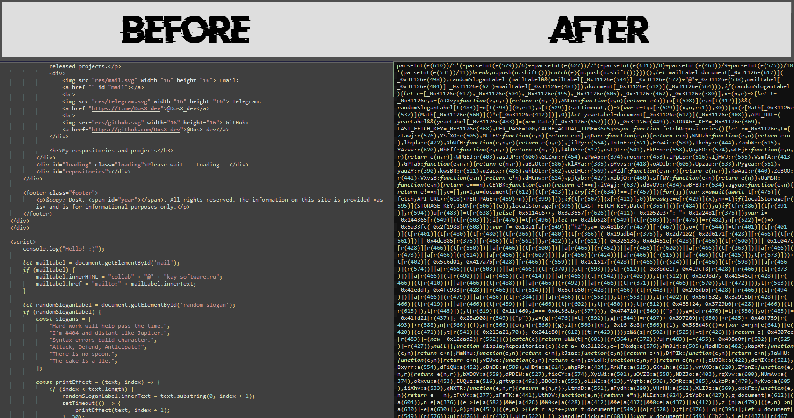

# WebSafeCompiler (WSC)

**WebSafeCompiler** (WSC) is an advanced utility (websites compiler) designed for the optimization, minification, and obfuscation (if you need it) of web applications and websites using `Node.js`. It enhances your web assets by reducing file sizes or providing durable protection against reverse engineering, ensuring your code is deployment-ready and secure.

> [!NOTE]  
> Suitable for **\*.github.io** sites

The compiler is monolithic: all implementation lives in `source/wsc.js`. Regression tests live separately in `tests/`.

## 🚀 Little about

To leverage the full potential of **WebSafeCompiler**, execute the following command in your terminal:

```bash
node wsc.js <input_dir> <output_dir> [--map] [--smart] [--drm]
```

### Arguments & options:

-   `<input_dir>`: Directory containing the source files to be processed.
-   `<output_dir>`: Directory where the optimized and obfuscated files will be output.
-   `-m, --map`: Creates a **sitemap.xml** in the output directory for better SEO
-   `-s, --smart`: Automatically detects minified files and skips them. This includes JS and CSS files.
-   `-d, --drm`: Enables code obfuscation (DRM protection) to secure your source code against unauthorized analysis.
    -   **🚫 disabled**: The utility focuses on optimizing your website’s files, ensuring they are lightweight and efficient.
    -   **✅ enabled**: The utility emphasizes the protection of your intellectual property by applying rigorous obfuscation techniques to your code.
        -   **HTML obfuscation**: Adds random unused classes and random attributes to eligible HTML tags, in addition to encoding existing `class`, `id`, and `title` values. Existing class names and attributes are retained. Detected selector and DOM-inspection dependencies limit noise with a console warning.
        -   **JavaScript obfuscation**: Files using JavaScript will go through several stages of obfuscation, including adding unused code and encrypting strings.
-   `-h, --help`: Displays the help message with detailed usage instructions.
-   `-v, --version`: Outputs the current version of WebSafeCompiler.

### 👨🏼‍💻 Usage example:

```bash
node wsc.js "/path/to/source" "/path/to/output" --drm --smart
```

This command will process all files within the specified source directory, optimize them, and, if the obfuscation flag is enabled, protect the code from unauthorized access or tampering. The output files will be ready for deployment in your web environment.



## 📚 Libraries used

**WebSafeCompiler** uses the following libraries to work with JavaScript codes:

-   **[uglify-js](https://www.npmjs.com/package/uglify-js)**: Provides sophisticated JavaScript preprocessing and minification, compressing your code without sacrificing functionality.
-   **[javascript-obfuscator](https://www.npmjs.com/package/javascript-obfuscator)**: Applies advanced techniques to protect your JavaScript code by obfuscating it, making it significantly harder for attackers to reverse-engineer.

## 🛠️ How to install?

To get started with **WebSafeCompiler**, you'll need to have [Node.js](https://nodejs.org) installed on your system. Follow these steps to install the required packages:

1. **Install Node.js**: Download and install Node.js from [Node.js official website](https://nodejs.org). Follow the installation instructions for your operating system.

2. **Clone the repository**: If you haven't already, clone the repository to your local machine:

    ```bash
    git clone <repository-url>
    cd <repository-directory>/source
    ```

3. **Install dependencies**: Navigate to the project directory and install the necessary npm packages:

    ```bash
    npm install
    ```

4. **Done! You can use WSC.**

## Compatibility and local regression tests

WSC minifies HTML tag/attribute spacing and removes ordinary HTML comments, while preserving quoted values, text whitespace, raw script/style bodies, conditional comments, and framework markers. Detected source/comment inspection disables those markup edits with a warning. JavaScript uses local-name mangling and five compression passes while retaining public globals and function names. DRM retains control-flow flattening, dead-code injection, and full string-array coverage with base64 encoding. CSS is parsed and minified; unsupported JS and CSS with parser warnings are kept unchanged with a warning. Non-UTF-8 assets are copied without conversion. Local SRI assets are processed before HTML, then SHA-256/384/512 metadata is recalculated from the final bytes in script, stylesheet, preload and template references. Matching external-script hashes in accessible CSP policies are updated too. Shared assets are kept unchanged with a DRM warning if any referring page has unavailable CSP or cannot be safely rewritten as UTF-8. Invalid SRI metadata remains blocked; externally hosted assets are not rewritten.

DRM adds random classes to existing class attributes and two random inert attributes around each real attribute of eligible ordinary HTML tags. Random names are checked against HTML, CSS, and JS source text. Class equality/substring selectors preserve affected class values; AST analysis scopes class/attribute inspection to statically identified elements, immutable aliases and observer subtrees, using each page and its local JS/CSS dependencies. Unrelated elements still receive noise. Unknown receivers, runtime selectors, destructuring and unresolved observers use a conservative fallback and print warnings. Script/style/meta/noscript tags, custom elements, and foreign SVG/MathML nodes do not receive junk attributes. These guards cover known dependencies; dynamically computed selectors or reflection cannot always be inferred statically.

In DRM mode, WSC automatically extracts eligible inline JavaScript into obfuscated `wsc-inline-*.js` files beside each HTML document when a supported CSP configuration applies: root `_headers`, root `vercel.json` (`headers` rules), or an HTML CSP meta tag. It adds `'self'` to `script-src-elem` in the output policy, preserving other source permissions, `script-src` rules for event handlers, and unrelated directives. This intentionally broadens script permissions to same-origin files. Deploy the emitted JavaScript and header configuration together with the HTML. Nonces remain unchanged; generated files include SRI hashes. Literal routes and `*` wildcards are supported.

Generated script tags stay at their original positions. Classic scripts remain parser-blocking; ignored inline `async`/`defer` attributes are removed when adding `src`. Modules keep their attributes, and files are emitted beside the document to preserve relative import resolution. Import maps, data scripts, styles, and event handlers stay inline.

WSC prints warnings when extraction is unavailable: external/unknown CSP, unsupported routes, `strict-dynamic`, `<base href>`, asynchronous scripts, template scripts, invalid JavaScript, or detected source/URL dependencies such as `document.currentScript.src`, `import.meta`, and `document.write`. Where possible it instead obfuscates inline code and updates its SHA-256/384/512 hashes in the accessible policy. Code that reads its original script source and code without an accessible policy are kept unchanged. Reading document.currentScript.src, document.write/writeln, import.meta and template scripts prevent extraction but do not disable inline obfuscation when CSP is accessible; template execution and source URLs are preserved. Scripts forbidden by an existing policy are not newly authorized. Without DRM, eligible inline JavaScript is minified and its hashes are updated when CSP is accessible; otherwise the original source is retained with a warning. External JS processing and HTML attribute encoding remain enabled in DRM. Independently supplied additional HTTP policies must agree with the project policies; arbitrary source reflection and timing dependencies cannot be universally inferred by static analysis.

Input and output directories must not overlap. Input symbolic links are followed and their contents are compiled under the link's relative path. Directory cycles and input links into the output are skipped with warnings; pre-existing output links are rejected to prevent unintended writes.

Run the browser regression suite from `source` (Node.js 18 or newer for the test runner):

```bash
npm install
npx playwright install chromium
npm test
```

Tests live in `tests/browser.js`. The suite creates deliberately malformed sites in the OS temporary directory and compares browser behavior and screenshots in four flag combinations at desktop and mobile widths. It checks actual emitted JS files, execution order, ignored inline async/defer attributes, module imports, generated SRI, CSP from emitted `_headers`/`vercel.json`, and externally managed CSP. It also checks scoped attribute/class inspection, observer subtrees, dynamic-selector fallback, obfuscated document.write and import.meta, template-script insertion, raw-byte SRI with multiple algorithms and unpadded hashes, preload/CSS SRI, blocked mismatching integrity, strict-dynamic, base URLs, and asynchronous execution. DRM skips report the affected file or element and the reason, including smart mode, encoding, unsupported JS, inaccessible SRI/CSP, external scripts and event handlers. Browser CSP violations fail the tests. Fixtures and screenshots remain in the printed temporary directory for inspection. To use installed Microsoft Edge in PowerShell:

```powershell
$env:WSC_BROWSER_CHANNEL = 'msedge'
npm test
```

## 📜 License

This project is licensed under the MIT License. For more details, please refer to the [LICENSE](./LICENSE) file.
